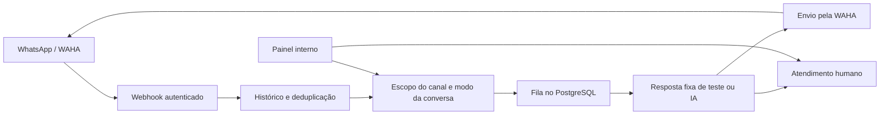

# WhatsAtend

Plataforma interna de atendimento pelo WhatsApp para múltiplas empresas, com automação configurável, fila persistente e intervenção humana.

O backend recebe eventos da WAHA, organiza o histórico por empresa e canal e controla quando uma conversa pode receber respostas automáticas.

## Recursos presentes no código

- Webhooks autenticados por canal e validação de eventos com Zod.
- Histórico e deduplicação de mensagens no PostgreSQL.
- Fila persistente com estados de envio, cancelamento e resultado incerto.
- Automação desativada por padrão e escopo configurável por canal.
- Pausa automática quando uma pessoa assume o atendimento.
- Retomada explícita pelo painel ou por reação elegível da própria conta.
- IA opcional por empresa, com contexto limitado e decisão estruturada entre responder e transferir para uma pessoa.
- Painel interno para empresas, canais, conversas, respostas manuais, conexão por QR e acompanhamento de uso de IA.

## Stack

| Camada | Tecnologias |
| --- | --- |
| Backend | Node.js 22+, TypeScript e Fastify |
| Persistência | PostgreSQL e migrações SQL |
| Integração WhatsApp | WAHA, com tratamento de eventos GOWS |
| IA | OpenAI Responses API |
| Testes | Node.js Test Runner, PGlite e simulação da API WAHA |
| Empacotamento | Dockerfile e GitHub Actions |

## Fluxo de atendimento



O controle combina `AUTO_REPLY_ENABLED`, escopo do canal e modo da conversa. Um canal `disabled` não recebe automação; `test` restringe a um identificador direto; `all` requer IA habilitada e confirmação explícita. Conversas em `human` exigem retomada.

## Estrutura

```text
src/app.ts          Rotas HTTP, autenticação e validação de webhooks
src/store.ts        Persistência, controle das conversas e fila
src/automation.ts   Configuração e cliente de envio
src/ai.ts           Integração e validação da resposta da IA
src/admin.ts        Rotas do painel interno
src/admin-page.ts   Interface do painel
sql/                Migrações versionadas
test/               Testes automatizados
Dockerfile          Build e execução do backend
```

## Desenvolvimento local

Requisitos: Node.js 22+, npm e uma instância PostgreSQL exclusiva para desenvolvimento. A integração real com WhatsApp exige uma WAHA configurada.

```powershell
npm ci
Copy-Item .env.example .env
```

Edite `.env`: configure `DATABASE_URL` e mantenha `AUTO_REPLY_ENABLED=false`. O provisionamento inicial também usa `COMPANY_NAME`, `WAHA_INSTANCE`, `WAHA_SESSION` e um `WEBHOOK_TOKEN` aleatório próprio do canal.

Os scripts não carregam `.env` implicitamente:

```powershell
node --env-file=.env --import tsx src/migrate.ts
node --env-file=.env --import tsx src/provision.ts
node --env-file=.env --import tsx src/server.ts
```

Execute o provisionamento no cadastro inicial, não a cada inicialização. A liveness fica em `/health/live` e a readiness em `/health/ready`.

O painel `/admin` só é montado com `ADMIN_SECRET` configurado e requer HTTPS para autenticação. Cadastro e conexão de canais pelo painel também dependem de WAHA e `PUBLIC_BASE_URL` válidos.

## Verificação

```powershell
npm run check
npm test
npm run build
```

O [workflow de CI](.github/workflows/check.yml) executa esses comandos. A suíte usa PGlite e uma API WAHA simulada para exercitar autenticação, isolamento, webhooks, automação, IA e painel.

Esses testes não substituem validação de concorrência em PostgreSQL real, conectividade com WhatsApp ou recuperação da infraestrutura.

## Decisões e limites

- **Intervenção humana:** resposta manual pausa a automação e cancela tarefas pendentes elegíveis.
- **Envio incerto:** timeout ou queda após iniciar o envio não provocam reenvio automático indiscriminado. O sistema registra a incerteza para conferência.
- **Separação por empresa:** autenticação de canal e relações compostas no banco. Esta implementação não usa RLS.
- **IA com transferência:** falhas ou decisão de handoff pausam a conversa. A saída estruturada não garante, por si só, a correção factual da resposta.
- **Escopo:** atendimento interno por texto; sem campanhas ou envio de mídia implementados.
- **Segredos:** chaves de API e tokens ficam no ambiente do servidor ou em arquivos locais protegidos.

Consulte [Operação e implantação](docs/operations.md) para configuração de canais, atualização, procedimentos do piloto e limites de envio.
